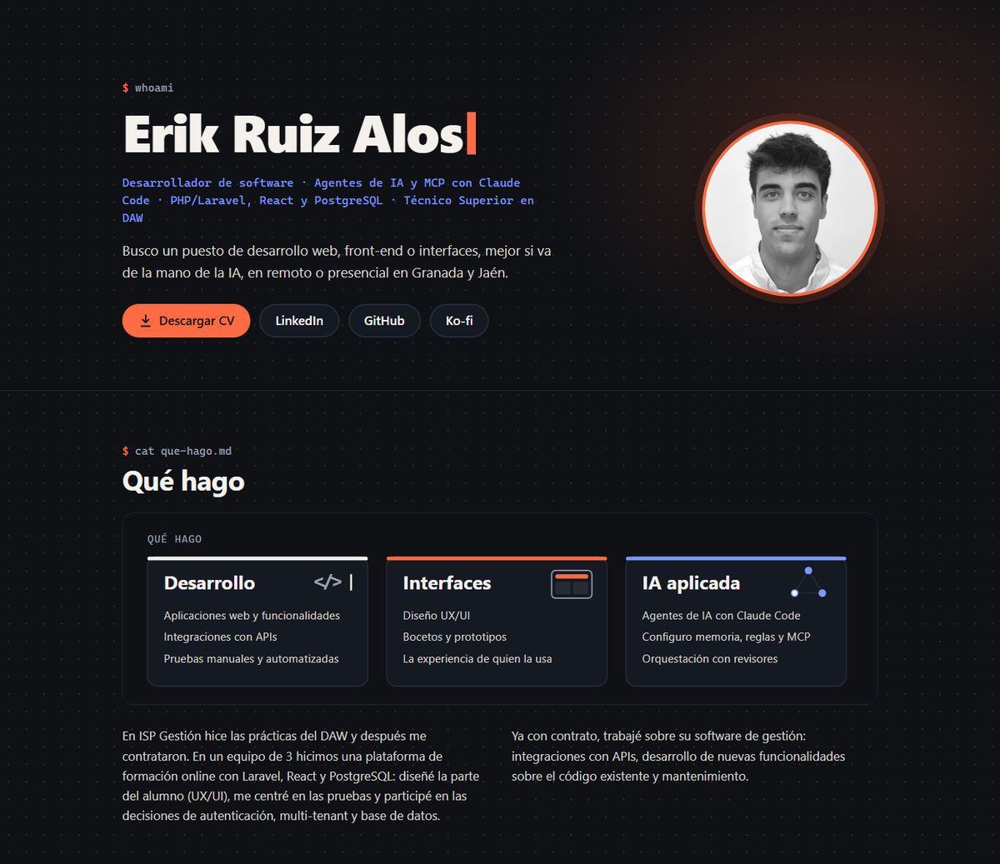

# Erik Ruiz Alos · Portfolio

Desarrollador de software: PHP/Laravel, React y PostgreSQL, y agentes de IA con Claude Code.

### [Ver mi portfolio: eriik-rz.github.io →](https://eriik-rz.github.io)

Se abre en el navegador, sin descargar nada. Ahí están mis proyectos, mi CV en PDF y mis enlaces.

[](https://eriik-rz.github.io)

## Qué hay dentro

- **Qué hago**: desarrollo, interfaces e IA aplicada.
- **Proyectos**: [Luzeira](https://eriik-rz.github.io/luzeira/), Forja de Héroes y un portal B2B.
- **Cómo trabajo con IA**: agentes que hacen las tareas y revisores que las comprueban.
- **Stack y trayectoria**.
- **[Descargar el CV](https://eriik-rz.github.io/cv/CV-Erik-Ruiz-Alos.pdf)**.

## Enlaces

[LinkedIn](https://www.linkedin.com/in/erik-ruiz-alos/) · [GitHub](https://github.com/eriik-rz) · [Ko-fi](https://ko-fi.com/eriik_rz) · [TikTok](https://www.tiktok.com/@eriik_rz.dev) · [Instagram](https://www.instagram.com/eriik_rz.dev/)

## Cómo está hecha

HTML y CSS, sin JavaScript, sin cookies y sin rastreadores. Se adapta al modo claro u oscuro de tu sistema y respeta «reducir movimiento». Se publica con GitHub Pages desde la rama `master`.

Para verla en local:

```bash
python -m http.server 8765
```

Después abre http://localhost:8765.
